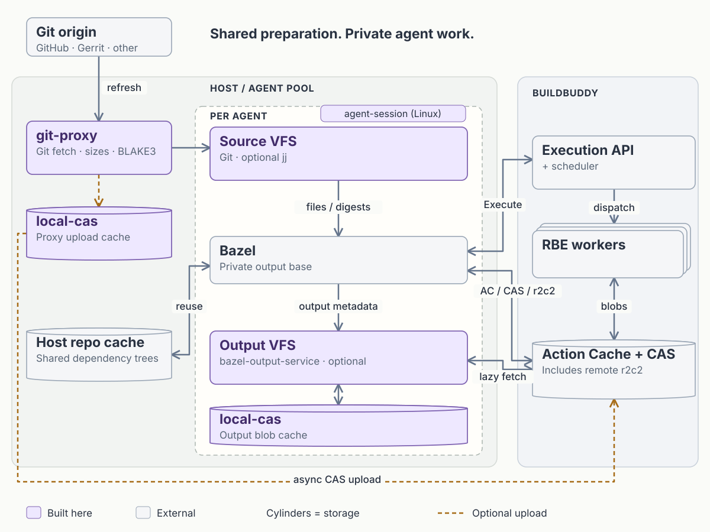

# git-tools

Lazy, writable Git/Jujutsu workspaces and local proxies for Bazel remote
execution. These experimental Rust tools let coding agents share cached bytes
without sharing source edits, Git state, or Bazel output bases.

## Architecture



**Purple:** project components. **Gray:** external tools/services.
Cylinders are storage; workers are a stack. This is a logical request map, not
a deployment topology.

`workspace` is the main entry point. One host daemon manages lazy mounts and a
shared content-addressable store (CAS). The Git proxy can run independently, as
shown, or be embedded for single-command setup. Bazel uses one `rbe.sock`
for cache, execution, remote downloader, build events and optional output service.
Execution stays remote: the proxy forwards requests to the scheduler, then workers.

Source inputs prefetch asynchronously; other files and enabled output mounts load
on demand. Only disposable, verified bytes enter the LRU cache. Source edits,
commits and unacknowledged build events are retained separately. Git mirrors and
packs are not covered by the CAS quota. A standalone Git proxy owns separate
cache storage; processes must not open the same local CAS directory concurrently.

## Quick start

The unified daemon currently runs on Linux. You need native Git, `/dev/fuse`,
`fusermount3`, compatible Bazel, and provisioned RBE credentials/toolchains.
Bazel must support BLAKE3, digest xattrs, r2c2 and the
[Unix-socket authority fix](https://github.com/bazelbuild/bazel/commit/242563f1a14378801725e5f6b0ee397ef0d307f2).
See [build setup](docs/development.md) and [platform support](docs/platforms.md).

```sh
bazel build --config=rbe //:workspace
export PATH="$PWD/bazel-bin/crates/workspace-daemon:$PATH"
workspace init
# Edit ~/.config/workspace/config.toml and provision credentials outside Git.
workspace create /tmp/agent-1 --repo bazel --revision FULL_COMMIT_SHA \
  --bazelrc /absolute/path/to/provisioned.bazelrc
workspace build /tmp/agent-1 -- //path/to:target
workspace status
```

Start from [the example TOML](examples/workspace.toml) for repository aliases,
upstream services and cache limits. `create` starts the daemon automatically.
Bazel's output service is opt-in (`bos.enabled = true`); enabled outputs are lazy.

```sh
git -C /tmp/agent-1/workspace status --short
workspace test /tmp/agent-1 -- //path/to:tests
workspace stop /tmp/agent-1
workspace resume /tmp/agent-1
```

Stop/resume preserves work. Native Git commits can hydrate missing indexed blobs;
general checkout, merge and rebase are not supported by the session workflow.
For agent provisioning and saving changes, see the
[cloud-agent example skill](examples/skills/cloud-bazel-agent/SKILL.md).

## Components

### Executables and their libraries

Use `workspace` for the integrated workflow; the other executables are standalone
entry points. Most also expose Rust libraries; `jj-native-cli` is executable-only.

| Crate | Executable | Purpose |
| --- | --- | --- |
| [`workspace-daemon`](crates/workspace-daemon) | `workspace` | Shared daemon, configuration and session lifecycle. |
| [`agent-session`](crates/agent-session) | `agent-session` | Standalone private Linux session lifecycle. |
| [`git-proxy`](crates/git-proxy) | `git-proxy` | Git mirror/fetch cache, object sizes, digest mappings and optional CAS uploads. |
| [`workspace-fuse`](crates/workspace-fuse) | `git-vfs` | Writable Linux FUSE source mounts. |
| [`workspace-nfs`](crates/workspace-nfs) | `git-nfs` | macOS source mounts over loopback NFS. |
| [`workspace-projfs`](crates/workspace-projfs) | `git-projfs` | Windows source mounts using ProjFS. |
| [`jj-vfs`](crates/jj-vfs) | `git-jj` | Jujutsu working-copy integration with the source VFS. |
| [`tinytree-server`](crates/tinytree-server) | `tinytree` | Separate jj-native object, reference, graph and content-query server over compressed gRPC. |
| [`jj-native-cli`](crates/jj-native-cli) | `tinytree-jj` | Native jj commands, publication, restore and scoped history/search through lazy workspaces. |
| [`bazel-output-service`](crates/bazel-output-service) | `git-output-service` | Lazy Bazel output service backed by remote CAS. |

### Library-only crates

| Crate | Purpose |
| --- | --- |
| [`workspace-core`](crates/workspace-core) | Git-backed source tree, lazy reads and prefetch scheduling. |
| [`workspace-overlay`](crates/workspace-overlay) | Persistent edits, writable namespace and change journal. |
| [`local-cas`](crates/local-cas) | Verified local blob storage with bounded LRU eviction. |
| [`packblob`](crates/packblob) | Indexed immutable blob packs with bounded dictionary compression and selective verified reads. |
| [`tinytree-model`](crates/tinytree-model) | Canonical jj-native objects, typed IDs and bounded verification. |
| [`tinytree-index`](crates/tinytree-index) | Rebuildable commit DAG, scoped graph facts and bounded content-search records. |
| [`tinytree-search`](crates/tinytree-search) | Shared bounded literal matching and trigram candidate filters for server search and local overlays. |
| [`tinytree-cloud`](crates/tinytree-cloud) | Verified jj operation/view recovery codecs; not an automatic backup service. |
| [`tinytree-proto`](crates/tinytree-proto) | Native repository gRPC bindings; not a server implementation. |
| [`tinytree-client`](crates/tinytree-client) | Bounded, verifying native RPCs and immutable transfer snapshots. |
| [`tinytree-store`](crates/tinytree-store) | Authoritative native objects, durable refs and reachability GC; not LRU. |
| [`jj-native-backend`](crates/jj-native-backend) | Native jj Backend and verified object-I/O providers; retains authoritative local objects. |
| [`jj-native-index`](crates/jj-native-index) | Immutable checkpoint-backed jj index over broker queries; not yet the default. |
| [`jj-native-remote`](crates/jj-native-remote) | Lazy native object I/O, checked query admission and durable publication. |
| [`native-broker`](crates/native-broker) | Private object, reference and query I/O over one local endpoint. |
| [`native-workspace`](crates/native-workspace), [`native-vfs`](crates/native-vfs) | Directory-at-a-time native source projection and platform mount ownership. |
| [`native-workspace-admin`](crates/native-workspace-admin) | Private external jj administration, sealed restore finalization and current-state resume. |
| [`native-vfs-controller`](crates/native-vfs-controller), [`native-vfs-rpc`](crates/native-vfs-rpc) | Dirty-only snapshots, checked root changes and private projection control. |
| [`native-retention`](crates/native-retention) | Durable workspace root claims and collection fences; not yet automatic client GC. |
| [`native-capture-pack`](crates/native-capture-pack) | Bounded local capture framing and verification; portable leases exclude private workspace state. |
| [`private-fs`](crates/private-fs) | Owner-private persisted state and filesystem identity checks. |
| [`grpc-transport`](crates/grpc-transport) | Response-body deadlines and resource lifetime guards for gRPC services. |
| [`git-pack-cache`](crates/git-pack-cache) | Reusable Git fetch/pack responses. |
| [`reapi`](crates/reapi) | Remote Execution API protocols and client policy. |
| [`cache-proxy`](crates/cache-proxy) | Cache, execution and remote-downloader forwarding. |
| [`bes-proxy`](crates/bes-proxy) | Durable, concurrent build-event forwarding. |
| [`output-core`](crates/output-core) | Durable output/source namespaces and lazy directory metadata. |
| [`output-fuse`](crates/output-fuse), [`output-nfs`](crates/output-nfs), [`output-projfs`](crates/output-projfs) | Linux, macOS and Windows output-mount adapters. |

For native repository test seeds, [tinytree-fixture](crates/tinytree-fixture)
provides a deterministic library and CLI without requiring Git conversion.

## Reference

[Source VFS](docs/vfs-reference.md) · [Git proxy](docs/proxy-reference.md) ·
[CAS sync](docs/proxy-cas-sync.md) · [Timeouts, retries and TTL](docs/reapi-policy.md) ·
[Output service](crates/bazel-output-service/README.md)
