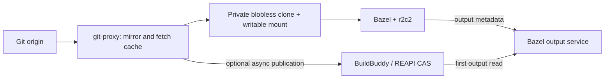

# Architecture and cache ownership

Git provides transport, object storage and history. Fjall stores metadata and
writable namespace state. Native filesystem adapters expose the workspace;
BuildBuddy supplies remote execution and CAS separately.

## What can be evicted?

| Storage | Ownership and cleanup |
| --- | --- |
| Workspace overlay, private Git admin, local commits | Authoritative user work; never delete as a cache |
| BOS state and locally edited outputs | Authoritative mutations; retain across restart; explicit Bazel clean is destructive |
| Git object databases/mirrors | Native Git format; no proxy mirror quota/automatic eviction; use Git-aware maintenance |
| Fjall size/BLAKE3 mappings | Disposable immutable metadata; remove only while no owner uses it |
| Generated Git responses | Separate request/ref-view cache; quota/TTL/LRU skip active readers |
| `local-cas` payloads | Verified immutable bytes; byte-bounded LRU skips active leases/download reservations |

Each cache directory has **one process owner**. Library consumers share
`Arc<LocalCas>`; separate proxy/BOS processes need separate directories.
Cache quotas cover logical payloads, not metadata, filesystem blocks or RSS.

Local CAS keeps maintained byte totals and an ordered unpinned-entry index.
Recency checkpoints are batched and restored on restart; contents are still
reverified. Crashes may lose recent touches. Active leases protect paths until
read/upload completion. Unlink remains serialized with lookup/pinning; asynchronous
deletion needs an explicit retiring state first. See the [crate API](../crates/local-cas/README.md).

## Boundaries worth preserving

- Digest identity includes backend authorization scope, instance, algorithm,
  hash and size. A raw Git SHA1 includes the object header; REAPI BLAKE3 does not.
- Staging output metadata never proves content availability. BOS checks retained
  remote outputs at `StartBuild`; a proxy TTL hint cannot replace that check.
- Native output publication must invalidate old bytes and missing-path caches
  before acknowledging success. A late old-generation read cannot replace new data.
- NFS has no close/forget callbacks or digest xattrs. ProjFS keeps writable data
  on NTFS. Do not copy Linux inode-GC rules blindly across platforms.
- Mirror and mapping retention need leases/refetch guarantees before eviction.
  The verified raw CAS cannot replace Git packs or authoritative writable files.

## Design sources

We borrow repository coordination from [Goblet](https://github.com/canva-public/goblet),
separate origin refresh/serving from [gitretriever](https://www.datadoghq.com/blog/engineering/gitretriever/),
and complete-response caching from [Packhorse](https://gitlab.com/gitlab-org/packhorse).
[Origin](https://cursor.com/blog/git-at-any-scale) reinforces native Git storage;
we do not implement its distributed write/replication layer.

Local eviction follows [EdenFS byte totals and recency indexing](https://github.com/facebook/sapling/blob/f787ffaceddd5a350212542fbe676702360f694a/eden/fs/store/ObjectCache-inl.h)
and [Buck2 batched access-time persistence](https://github.com/facebook/buck2/blob/5cb30436e4070ecf0770fef256e157fd467ec734/app/buck2_execute_impl/src/materializers/deferred/command_processor.rs).
Our hard file leases are stronger than Eden's in-memory interest handles.
