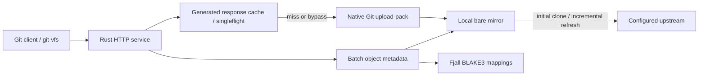

# Pull-through Git cache design

## Scope

`git-proxy` is a Rust service that caches configured upstream repositories and
serves ordinary Git clients and `git-vfs` over smart HTTP.
It is not a new Git forge, a push destination, or a REAPI CAS server.

## Research and decisions

### Canva Goblet

[Canva's Goblet fork](https://github.com/canva-public/goblet) separates upstream
requests from locally serviceable fetches. Its
[repository manager](https://github.com/canva-public/goblet/blob/master/managed_repository.go)
serializes cache updates, while its
[protocol handler](https://github.com/canva-public/goblet/blob/master/git_protocol_v2_handler.go)
decides which requests can be served locally.
We borrow repository-scoped coordination and rechecking state after acquiring
refresh ownership. We do not copy its implementation or its GitHub App setup.

### Cursor Origin

[Cursor's architecture article](https://cursor.com/blog/git-at-any-scale)
describes Origin and its Continuity storage layer: ordinary Git repositories
on local storage remain useful, while a separate authoritative log coordinates
durability and replica consistency.
We retain native pack storage and treat the cache as rebuildable from its
upstream. Native Git installs objects before publishing fetched refs.
This read-only prototype does not need Origin's distributed write-ahead log,
replica consensus, or shared pack compaction machinery.

### Datadog gitretriever

[Datadog's gitretriever article](https://www.datadoghq.com/blog/engineering/gitretriever/)
separates a small upstream-facing mirror tier from a larger serving tier and
discusses reuse of indexed packs and repeated fetch responses.
We separate upstream refresh from local serving and provide a metadata API for
clients that do not need file contents. Relay replicas remain future work.

### GitLab Packhorse

[Packhorse](https://gitlab.com/gitlab-org/packhorse) caches generated fetch responses
and coalesces equivalent work; its design also includes object-storage offload
using Git's packfile-URI extension. We implement the local response-cache and
singleflight boundary, not the object-storage tier.

Only conservatively recognized complete protocol-v2 fetch requests receive keys.
Repository identity, refresh epoch, capabilities, and exact pack-affecting request
arguments partition entries. Agent/session identifiers may differ without changing
the key. Unknown semantics bypass instead of guessing equivalence. A refresh
attempt advances the epoch even on failure/cancellation, so a partially completed
refresh cannot leave prior responses reusable after refs changed.

The producer streams to its first client while writing a bounded temporary file.
Followers wait for the full successful response; they never consume a partial
file. Native exit status and protocol framing gate atomic publication. A failed
or oversize fill releases followers to uncached generation. A hard fill deadline
also covers blocked client sends. Total disk reservations, entry count, TTL, LRU,
and reader leases bound the generated-response cache. The index intentionally
starts cold after process restart. See the [proxy guide](../crates/git-proxy/README.md#generated-fetch-response-cache)
for limits and observability.

## Cache boundary and freshness

Repository aliases resolve to operator-configured upstreams. Client-controlled
paths cannot select an arbitrary upstream or a filesystem repository.
The first request initializes a full bare mirror and publishes it only after
initialization succeeds. Concurrent requests coordinate around that work.
Later refreshes follow the configured freshness interval.
That interval permits stale refs; it is not a strong read-after-write guarantee.

A full mirror is deliberate. A server-side partial clone would lack sizes for
missing blobs unless its own upstream exposed metadata or the proxy fetched
their contents. Paying for full contents at the proxy lets many blobless VFS
clients reuse one local size and content source. Cold proxy initialization must
therefore be measured separately from a warm proxy with a fresh client.

## Object metadata

The native Git server enables `transfer.advertiseObjectInfo=true` and filtered
fetches. It serves protocol-v2 `object-info` without depending on the upstream
forge advertising that capability. Native Git handles command capabilities,
packet framing, and pack negotiation. The Rust frontend passes the HTTP
`Git-Protocol` header to Git's `GIT_PROTOCOL` environment variable and rejects
push endpoints; receive-pack is also disabled in Git.

The JSON batch API accepts full SHA1 object IDs. Size-only queries read object
metadata, not blob contents. Optional BLAKE3 lookup reads raw blob contents on
the proxy on its first miss and persists the result in Fjall. Trees and commits
are not file digests. Git LFS pointer sizes describe the pointer blob, not the
external LFS payload.

Git SHA1 includes Git's object header; REAPI BLAKE3 does not. The mapping is
therefore computed from contents, not derived mathematically from the SHA1.
The API returns both hash and byte size. It neither uploads blobs to a CAS nor
proves that a remote CAS contains them.

## Initial deployment boundary

The default listener is loopback, and repositories share the service's upstream
access. Client authentication and per-user upstream authorization are not
implemented. Do not treat the cache as a multi-tenant authorization boundary.
TLS termination, authorization, mirror eviction, distributed replicas, and background
maintenance are outside this prototype. Generated-response eviction is implemented
independently of mirror retention.

## Validation

The integration suite exercises real native Git clients against a local test
upstream. Required behaviors include shallow and blobless clone, ref refresh,
object-size lookup without client blob hydration, optional raw-content BLAKE3
lookup, persistence, cold-request coordination, and rejected push/invalid paths.
Performance measurements must separate cold proxy population, warm proxy with
a fresh VFS clone, and warm VFS queries.
